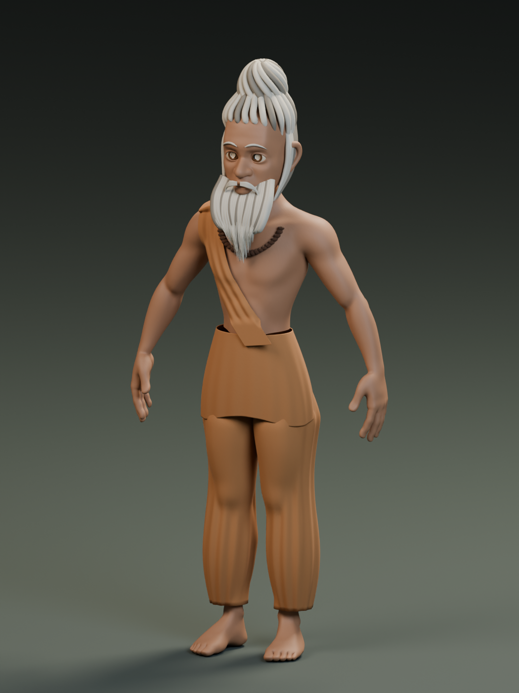

# Rishi 001 — reusable Blender character

A stylized elderly forest sage for recurring Blender films and animations. **Version 0.2 uses Blender's CC0 human base mesh**, preserving its quad anatomy and UVs, with a refitted body/finger rig, facial controls, beard controls and separate costume.



## Current character

- [Blender master v0.2](rishi/v2/Rishi_Character_Master_v2.blend)
- [Portable GLB v0.2](rishi/v2/Rishi_Character_v2.glb)
- [Usage, migration details and limitations](rishi/v2/README.md)
- [Topology and UV preservation report](rishi/v2/migration-report.json)
- [Saved-file and export validation](rishi/v2/validation-report.json)
- [Imported source and provenance](rishi/source-assets/README.md)

Open the master in Blender 5.2.1 LTS. For a film shot, link the `RISHI_001_CHARACTER_V2` collection and create a Library Override. Select `Rishi_Rig` to pose the body and adjust its `blink`, `brow_raise`, `smile`, and `jaw_open` custom properties.

The source anatomy is **Body Male – Stylized**, by **Julien Kaspar**, from **Human Base Meshes v1.4.1** (CC0). The body retains 12,502 vertices, 12,500 quad faces and its original UVs. The previous procedural prototype remains in `rishi/Rishi_Character_Master.blend` for reference.

## Scope

This is a reusable character prototype, not a finished dialogue-performance rig. Close-up speech needs a complete mouth/viseme system; extreme poses need further deformation work. The supplied pose renders and validation report state what has been checked. The GLB does not preserve Blender expression drivers or procedural bump materials.

The rishi is an artistic composite informed by scriptural descriptions of forest ascetics, not a universal depiction of every rishi. Sources and design choices are in the [design notes](rishi/README.md#scriptural-references-and-limits).

## Build and validate

With Blender available on your PATH, run from the repository root:

```sh
blender -b --python rishi/scripts/migrate_to_human_base.py
blender -b --python rishi/scripts/validate_human_base.py
```

Building replaces generated v0.2 files and previews. Keep film shot files separate. The original v0.1 builders remain available under `rishi/scripts/`.
