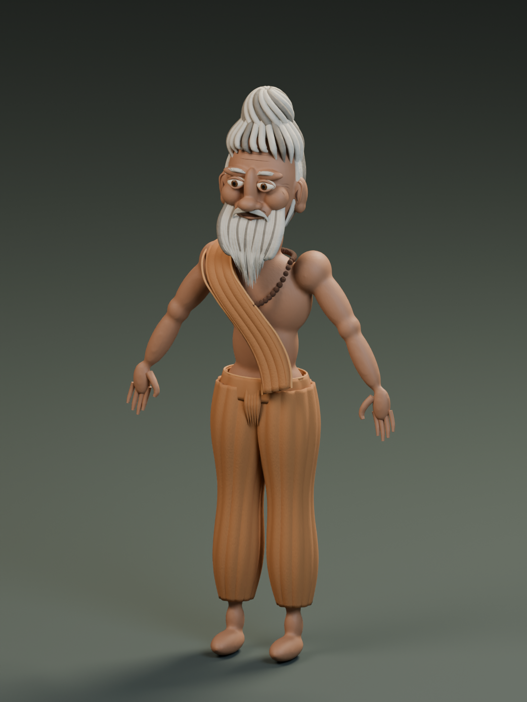

# Rishi 001 — reusable Blender character

A stylized elderly forest sage for recurring Blender films and animations. This **v0.1 prototype** includes a 55-bone FK rig, articulated fingers, beard controls, facial sliders, separate clothing and hair, and a character collection marked for reuse through Blender's Asset Browser or linked libraries.



## Start here

- [Blender character master](rishi/Rishi_Character_Master.blend)
- [Portable GLB](rishi/Rishi_Character.glb)
- [Usage, design references and limitations](rishi/README.md)
- [Saved inspection poses](rishi/poses.json)
- [Geometry and weighting report](rishi/character-report.json)
- [Saved-file and export validation](rishi/validation-report.json)

Open the master in Blender 5.2.1 LTS. For a film shot, link the `RISHI_001_CHARACTER` collection and create a Library Override. Select `Rishi_Rig` to pose the body and adjust its `blink`, `brow_raise`, `smile`, and `jaw_open` custom properties.

## Scope

The character is an artistic composite informed by scriptural descriptions of forest ascetics, not a universal depiction of all rishis. Scriptural references and design choices are documented in the usage guide.

The rig, expression drivers, supplied poses, and GLB reimport were checked. This remains a prototype: close-up dialogue needs a complete mouth/viseme system, and demanding motion needs animation retopology and further deformation refinement. The GLB does not preserve Blender expression drivers or procedural bump materials.

## Build and validate

With Blender available on your PATH, run from the repository root:

```sh
blender -b --python rishi/scripts/build_character.py
blender -b --python rishi/scripts/validate_character.py
```

Building replaces generated character files and previews. Keep film shot files separate. The original static seated design study is included as `rishi/Wise_Rishi.blend`.
